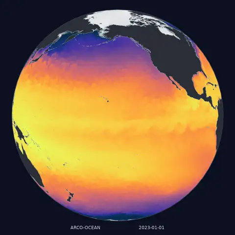

# The ARCO-OCEAN Dataset

[](https://doi.org/10.5281/zenodo.17751608)

<p align="center">
  
</p>

*Sea surface temperature (`thetao`, top level) and sea ice (`siconc`, white) of 2023 at 0.25°, day
by day. Generated using E.U. Copernicus Marine Service Information
([10.48670/moi-00021](https://doi.org/10.48670/moi-00021)).*

ARCO-OCEAN gives the ocean state and its forcing on regular latitude-longitude grids at 0.25°,
0.5° and 1°, one value a day, from 1 January 1993 to 30 June 2026: the ocean and sea ice from the
GLORYS12 reanalysis and the atmosphere from ERA5, with daily forecasts of the same variables. It
is built for training machine learning models of the ocean, and stored as Icechunk repositories
on AWS S3, readable without credentials.

**Everything else is on the site: <https://stefanocampanella.github.io/arco-ocean/>**, written
from `docs/`:
[data](docs/data.md), [access](docs/access.md), [sources](docs/sources.md),
[coarsening](docs/coarsen-ocean-datasets.md), [producing](docs/producing.md),
[forecasts](docs/forecasts.md), [licence](docs/licence.md), [development](docs/development.md).

## Quick start

```python
import icechunk
import xarray as xr

storage = icechunk.s3_storage(
  bucket="ogs-arco-ocean",
  prefix="historical/res=0p25",
  region="eu-south-1",
  anonymous=True,
  network_stream_timeout_seconds=20,
)
repo = icechunk.Repository.open(storage)
dataset = xr.open_zarr(repo.readonly_session("main").store, consolidated=False)
```

To work on this repository: `uv sync` (the package and the checks), `git submodule update --init`
(the scripts' tests), `uvx pre-commit install` ([Development](docs/development.md)).

## Licence and citation

The datasets are released under CC BY 4.0, crediting their sources as each repository's
`attribution` attribute says; the code under the MIT licence ([LICENSE](LICENSE))
([Licence](docs/licence.md)).

```
Campanella, S., Salon, S., Querin, S., and Bortolussi, L.: ARCO-OCEAN: A dataset of physical properties of the ocean and sea ice, with hydrological and atmospheric forcing, optimized for machine learning. https://doi.org/10.5281/zenodo.17751608
```
