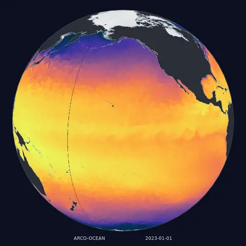

# An animation of ARCO-OCEAN (design)

Roadmap item 5: an animation for the Earthmover marketplace listing and the documentation. This
was a proposal; the maintainer chose its content and text on 23 Nov (Decisions, below).

*The animation, made on 24 Nov by [scripts/animation.py](../scripts/animation.py) (How it is
made, below). Generated using E.U. Copernicus Marine Service Information
([10.48670/moi-00021](https://doi.org/10.48670/moi-00021)).*

## What it shows

**A rotating globe with a year of the ocean's surface.** One frame per day; sea surface
temperature as colour; sea ice drawn over it in white, its opacity the concentration; land
dark. While the year runs, the globe turns once, so each ocean comes into view in its own
season:
- the Pacific's equatorial cold tongue;
- the Gulf Stream and the Kuroshio;
- the Arctic ice melting back in summer, and the Antarctic ice growing in austral winter.

**The year.** 2023, El Niño's onset, when the eastern Pacific warms over the months.
It is within the historical dataset and well known; any year works.

## Why this design

- **One variable, one colour map.** Temperature is a magnitude, so it gets one sequential,
  perceptually uniform colour map: cmocean's `thermal`, dark purple to yellow. It reads under
  colour-vision deficiencies, unlike a rainbow, and stays legible on the dark background.
- **Sea ice in white over it.** No second colour scale: white is outside the colour map, and its
  opacity is the concentration, so the ice edge is soft where the ice is thin.
- **A globe, not a map.** A rotating globe avoids the distortion of flat maps at the poles,
  where the ice is, and shows ocean and ice together as one system, which is what the dataset
  merges.
- **A loop for the marketplace.** A frame a day, 365 frames at 30 per second (12 s), and one
  turn of the globe. It loops without a jump in rotation, though one in season.

## Alternatives considered

1. **Surface currents.** Speed from `uo`/`vo` (cmocean `speed`, on black), with particles
   advected along the currents. The most striking option, but rendering particles needs more
   than cartopy (a GPU renderer, or a few days of work), and the current speed at 0.25° is
   noisy.
2. **Anomalies.** Temperature minus the climatology (the statistics' `climatology` group), on a
   diverging map (blue, grey at zero, red). It shows El Niño best, but it needs the statistics
   and a legend that explains the anomaly.
3. **Depth.** A slice through the levels (temperature along the equator, 0-500 m) next to the
   globe: it shows that the dataset is 3D, but two panels are less suited to a thumbnail.

## How it is made

`uv run --script scripts/animation.py [--zarr] SOURCE OUTDIR` (dependencies inline; the options
in its help). Made on 24 Nov 2026:
- **Data.** Level 0 of `thetao` and `siconc` for the 365 days of 2023 at 0.25°, read anonymously
  once (about 3 GB) and cached in OUTDIR per source. Made from the dataset published before
  (`s3://ogs-arco-ocean/datasets/res=0p25`, `--zarr`), since the new historical repository is not
  written yet: its sea ice was averaged with open water as 0 along coasts, which the new recipes
  fix. Run the script again on `historical/res=0p25` once it is published.
- **Frames.** One image per day (temperature in `thermal`, ice blended in white, land dark),
  warped by cartopy onto an orthographic globe centred at 12° N (the equator's ocean in view,
  the Arctic at the rim), with Natural Earth's 50 m coastlines; 1080 x 1080 pixels. The centre
  moves west by 360/365° a frame, so the surface moves east as the Earth's does. 365 frames take
  about a minute on the project machine, in parallel processes.
- **Outputs.**
  - `assets/arco-ocean.webp` (480 x 480, 4.9 MB): the README's cover, and the web page's,
    loaded when scrolled to (the still globe for readers who ask for less motion).
  - `assets/arco-ocean.png`: the first frame's globe, the web page's icon.
  - An MP4 (H.264) and a WebM (VP9), 1080 x 1080, about 5 MB each, for the marketplace: not
    committed.
  - Each credits the Copernicus Marine Service where it is shown; the images are CC BY 4.0, as
    the data.

## Decisions (maintainer, 23 Nov)

1. **Variable and year:** sea surface temperature with sea ice, in 2023, as proposed.
2. **Text:** the title and a running date, small, near the centre of the bottom edge, so that a
   thumbnail cropped to the centre keeps them; no colour bar.

## Open points

1. **Branding:** Earthmover's marketplace may have size and length requirements, to check when
   listing (roadmap item 10).
